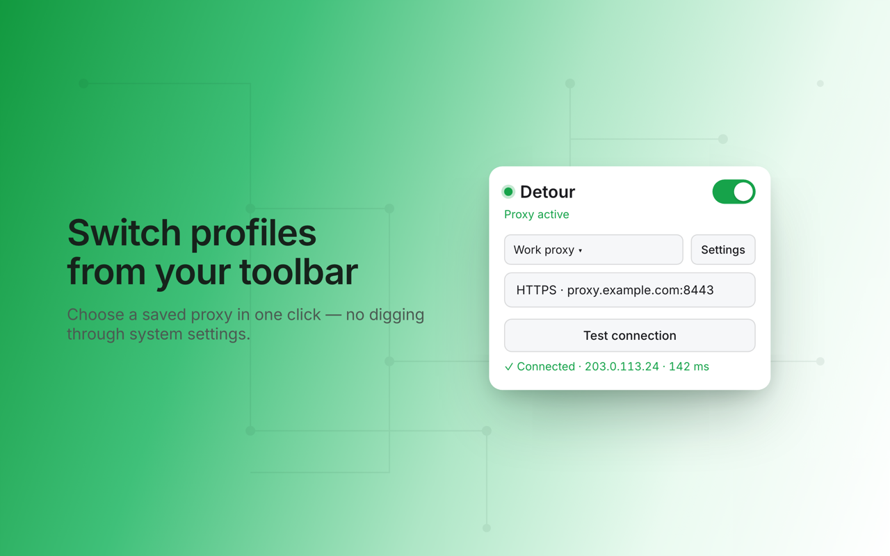

# Detour

A proxy switcher for Chrome and Firefox. Save your proxies as profiles, switch
between them from the toolbar, and send chosen sites through a different proxy
or straight to the network.

[](https://github.com/mathieumaf/detour/actions/workflows/ci.yml)



## Install

- **Chrome, Edge, Brave, Opera, Vivaldi, Arc**: [Chrome Web Store](https://chromewebstore.google.com/detail/detour/ajfhkoilhlahkkbmnbcfoolbfhpfdpjp)
- **Firefox** (140 or later): [Firefox Add-ons](https://addons.mozilla.org/en-US/firefox/addon/detour-proxy/)

## What it does

- **Profiles.** Keep several HTTP, HTTPS, SOCKS4, or SOCKS5 proxies and pick the
  active one from the popup.
- **One-click toggle.** Turn the proxy on or off from the toolbar. The icon
  shows an ON badge while it is active.
- **Rules.** Send a host through a chosen profile, or directly, whatever the
  active profile is. The first matching rule wins.
- **Bypass list.** Per profile, list the hosts that skip the proxy.
- **Authentication.** Detour answers the proxy's password prompt with the
  credentials you saved.
- **Connection test.** Check a proxy before you rely on it. The test reports the
  exit IP and how long the request took.
- **Health checks and failover.** Optionally re-test the active proxy on an
  interval. After repeated failures Detour switches to a fallback profile, or
  turns itself off if the fallback is down too.
- **Keyboard shortcuts.** Bind a key to the toggle and to "next profile".
- **Import and export.** Back up everything to a JSON file. Import also reads a
  SwitchyOmega backup.

The [user guide](docs/usage.md) covers each of these, including the pattern
syntax that rules and bypass lists share.

## Browser support

| Browser                                  | Proxy | HTTP / HTTPS auth | SOCKS auth |
| ---------------------------------------- | ----- | ----------------- | ---------- |
| Chrome, Edge, Brave, Opera, Vivaldi, Arc | yes   | yes               | no         |
| Firefox                                  | yes   | yes               | yes        |
| Safari                                   | no    | no                | no         |

Chromium browsers cannot send a username and password to a SOCKS proxy. That is
a browser limitation, so the settings page disables those fields there. Safari
has no proxy API for extensions.

## Privacy

Detour collects nothing. Your profiles and passwords stay in the browser's
local extension storage. The only requests Detour makes on its own are
connection tests and health checks, which ask `api.ipify.org` for the exit IP
through the proxy being tested. See [PRIVACY.md](PRIVACY.md).

## Develop

You need [Bun](https://bun.sh) 1.4.5 and Node 26.

```sh
bun install
bun run dev            # Chrome with the extension loaded, reloading on change
bun run dev:firefox    # the same in Firefox
```

Before you open a pull request:

```sh
bun run check          # lint, formatting, types, unit tests with coverage
bun run browsers       # once: download the Chrome and Firefox the e2e suite drives
bun run test:e2e       # the end-to-end suite, on Chrome and then on Firefox
```

To load a build by hand, run `bun run build` and load `.output/chrome-mv3` from
`chrome://extensions` (Developer mode, then "Load unpacked"). For Firefox, run
`bun run build:firefox` and load `.output/firefox-mv3/manifest.json` from
`about:debugging`.

## How the code is laid out

```
src/
  core/          The proxy model and all its logic. No browser APIs: plain
                 TypeScript, covered by unit tests.
  entrypoints/
    background/  Applies the stored state to the browser. One engine with a
                 Chromium backend and a Firefox backend.
    popup/       The toolbar popup.
    options/     The settings page.
  components/    Vue components for the two pages.
  composables/   The state the pages share.
  utils/         Thin wrappers over chrome.storage and runtime messaging.
e2e/             End-to-end tests that drive real Chrome and Firefox.
scripts/         Store packaging and its checks.
store/           Store listing copy and artwork.
docs/            Guides, listed below.
```

## Documentation

- [User guide](docs/usage.md): profiles, rules, patterns, health checks, import.
- [Architecture](docs/architecture.md): how the pieces fit, and how to add to them.
- [Testing](docs/testing.md): what each test layer covers and how to run it.
- [Releasing](docs/releasing.md): from a merged pull request to both stores.
- [Contributing](CONTRIBUTING.md) and the [security policy](SECURITY.md).

## License

[MIT](LICENSE.md) © Mathieu Mafille
